# Pear reference study for Adam’s portfolio

Researched **11 October 2026**. Reference: [pear.no](https://pear.no/).

## Design conclusion

Borrow the contrast between expressive imagery and disciplined editorial layout: fine rules, deliberate whitespace, a strong headline, small mono labels, and carefully staged motion. Build the imagery and narrative around Adam’s technology, creative work, projects, and writing. Pear’s classical figures and partnership sales pitch belong to its identity; they are not the proposed identity for this portfolio.

This document is research and a proposed direction, not a selected design or an implementation. No portfolio application files were changed.

## Scope and evidence

Inspected the live site in the Codex in-app browser at its original **862 × 764** viewport, **1440 × 900** desktop, and **390 × 844** mobile viewport. Used actual navigation, scrolling, keyboard input, screenshots, DOM/accessibility inspection, and public HTML/CSS/JavaScript. Mobile testing used a narrow desktop-browser viewport, not a physical phone or touch-device performance test.

Screenshots are numbered by capture order. Animated scenes have no single canonical still. Captures below are accepted examples of the observed states, rather than a promise of identical rendering on every visit. Initial blank/transitional captures were excluded. The existing portfolio was inspected in source, not visually audited in this study.

## 1. Visual language

### Art direction

- A theatrical, almost museum-like world: draped classical figures, marble, scaffolding, foliage, and an intense blue background.
- Organic painted imagery is juxtaposed with technical interface marks: hairline grids, ruler ticks, progress marks, and small star-like intersections.
- Depth comes from large cropped figures, foreground curtains, layered imagery, perspective, and motion. Conventional rounded cards are not the dominant page structure.
- Digital texture interrupts the classical imagery: stippled/halftone clouds, dissolving edges, distortion, and chromatic fringes.
- The page alternates expressive scenes with a quieter, near-black ending. The grid supplies continuity across those changes.

### Typography and tokens

These are values from the delivered CSS, not colors guessed from screenshots.

| Role | Evidence from Pear | Adaptation opportunity |
| --- | --- | --- |
| Main display | `Flecha M`, with `Flecha S` and system serif fallbacks; light weight 300 | Explore a distinctive serif for a small number of display moments |
| Body | `GT Standard L` | Keep highly readable sans-serif body text |
| Labels and navigation | `GT Standard Mono`; uppercase and tracking | Build on the portfolio’s existing mono labels and numbered index |
| Dark surface | `#0b0a09` | Consider a softer near-black in place of pure black |
| Paper | `#f2f1ed` | Warm neutral surface for selected editorial sections |
| Ink | `#1d1c19` | Dark type on paper surfaces |
| Sky token | `#015186` | A reference for saturation, not a requirement to make Adam’s site blue |
| Easing | `cubic-bezier(.22,1,.36,1)` | Quick movement followed by a soft settle |
| Hero scale | `clamp(30px,5.357vw,96px)`; line-height 1 | Fluid headline sizing with tested line breaks |

The measured hero font at 862px width was Flecha M, 46.2px, weight 300. CSS also declares Flecha L and multiple optical variants. Font files are self-hosted WOFF2, with some WOFF fallbacks and `font-display: swap`. A fallback name in CSS does not mean that font is downloaded or rendered. Any adoption of commercial fonts would require appropriate licensing; the type pairing can also be explored with the portfolio’s existing fonts first.

## 2. Observed journey and UI behavior

### Step 1 — Arrival: striking, with mobile contrast risk

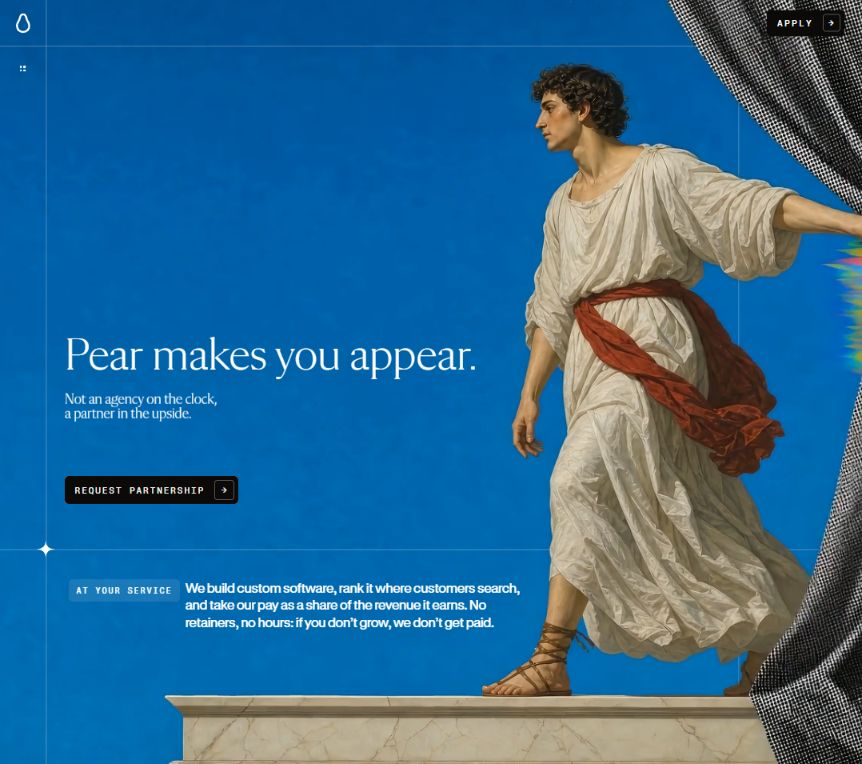

The image dominates the viewport while headline, support copy, and a compact primary action occupy the left. Fine horizontal and vertical rules make the scene feel composed rather than decorative. The logo occupies a small corner cell; the menu is a four-dot icon. The main action uses a compact rectangular treatment and a separate arrow box.

At narrow widths, the figure is aggressively cropped and moves behind text. That preserves impact but sometimes places white copy over pale clothing. Contrast must be checked over the full moving background, not only a favorable frame.

### Step 2 — Chapter navigation: elegant presentation, keyboard issue

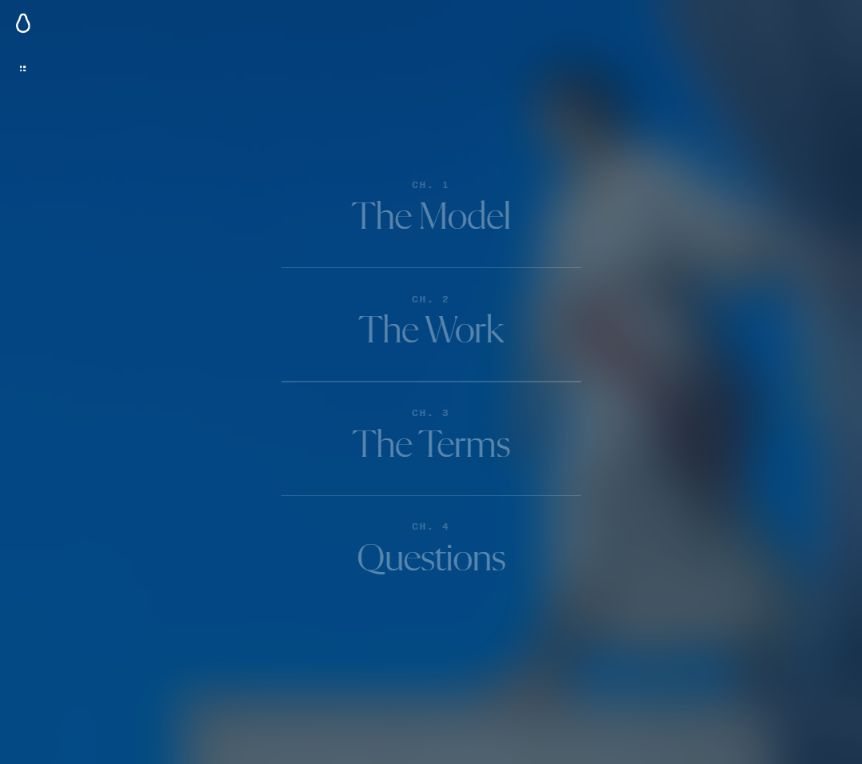

The menu creates a full-screen blurred backdrop with four centered chapter links, serif titles, tiny mono chapter numbers, and thin separators. Opening changes the button’s accessible name from Menu to Close and updates `aria-expanded`. Selecting a chapter closes the menu and moves to a position in the scroll timeline. Escape closed the menu in the keyboard check.

**Confirmed concern:** on mobile-width layout, pressing Tab after opening the menu moved focus from Close to the background hero CTA, instead of into the chapter links. The overlay does not reliably contain focus. Preserve the portfolio’s existing mobile-menu focus management rather than importing this behavior.

### Step 3 — Opening/model sequence: compelling motion, substantial scroll commitment

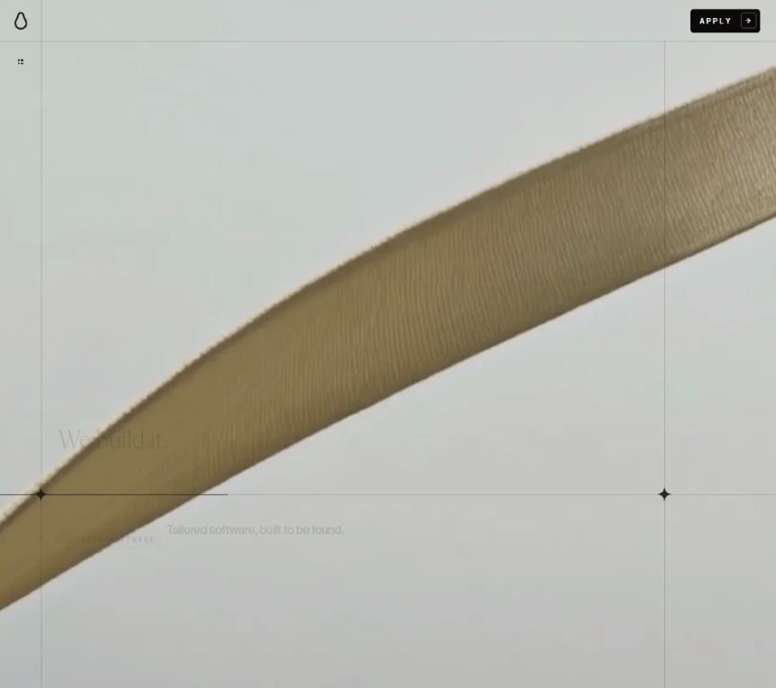

This is an intentional motion sample: the short text is fading while a large golden form crosses the scene. Scroll changes the presentation within a pinned viewport instead of simply moving document sections upward. Text is split into characters and staged in short beats; imagery transforms independently.

The timeline is extremely long: CSS sets the stage to **5350vh** on desktop and **7300vh** below 720px. At 1440 × 900, the measured document height was 48,150px. The chapter shortcuts are therefore important to the experience. For a portfolio, keep any cinematic introduction short and make project access independent of completing it.

### Step 4 — Work chapter: editorial asymmetry, reading-order concern

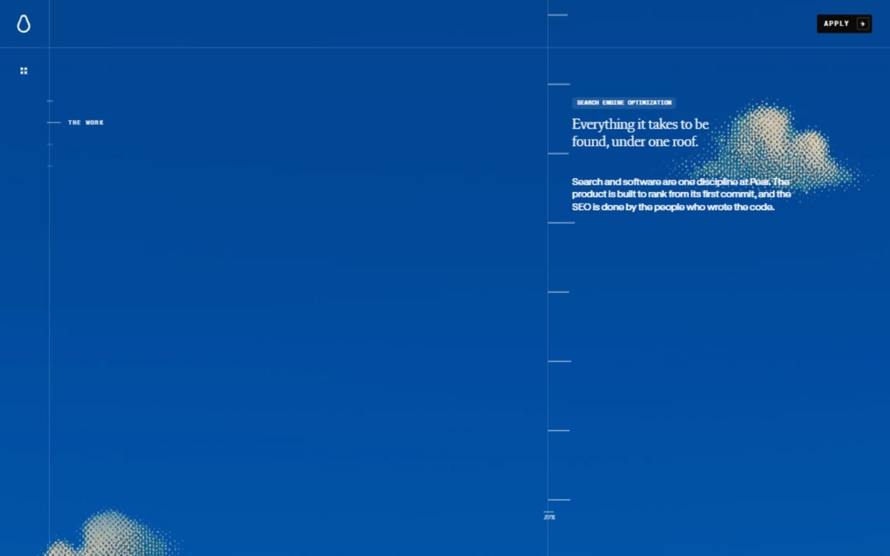

An oversized blue field balances a narrow right-hand text column. A ruler-like divider and halftone clouds reinforce the technical/editorial combination. The left rail indicates the current chapter. Scroll stages the text and scene rather than presenting a simple list of project cards.

**Confirmed concern:** during inspection, the work layer was visually displayed but its container remained `aria-hidden="true"`; its text was absent from the returned accessibility tree. The same mismatch was observed for the questions layer. This is a meaningful accessibility issue to avoid in any adaptation. A full screen-reader session was not performed.

At the original 862px viewport, one observed work state extended text past the right edge. Because it occurred within the animated presentation, treat this as a breakpoint/transition risk to retest, not a claim that every work state is clipped.

### Step 5 — Terms transition: strong visual storytelling; text coverage limited

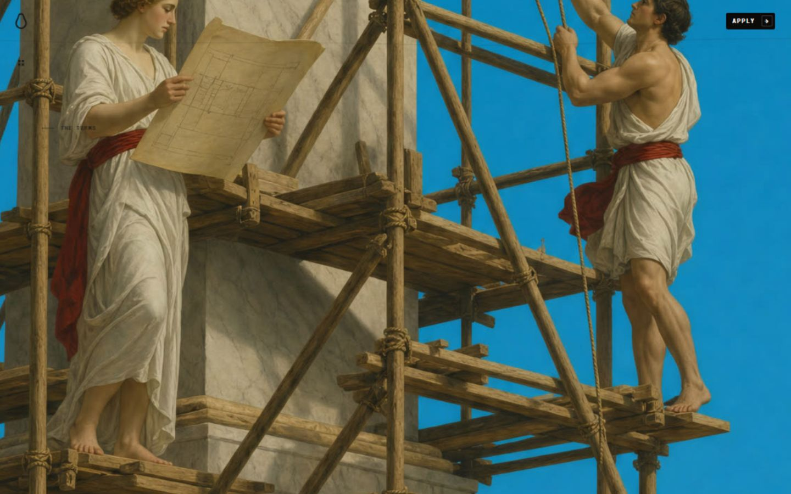

The scene shifts to people constructing a monumental object on scaffolding, making the collaboration theme visual. This capture documents the chapter entrance, not the later terms copy. Public DOM/source inspection confirmed the explanatory headings and paragraphs, but this study did not obtain a stable screenshot of every later text beat. Do not use this image as proof of those text layouts.

### Step 6 — Questions: distinctive spatial cards, weaker scanning

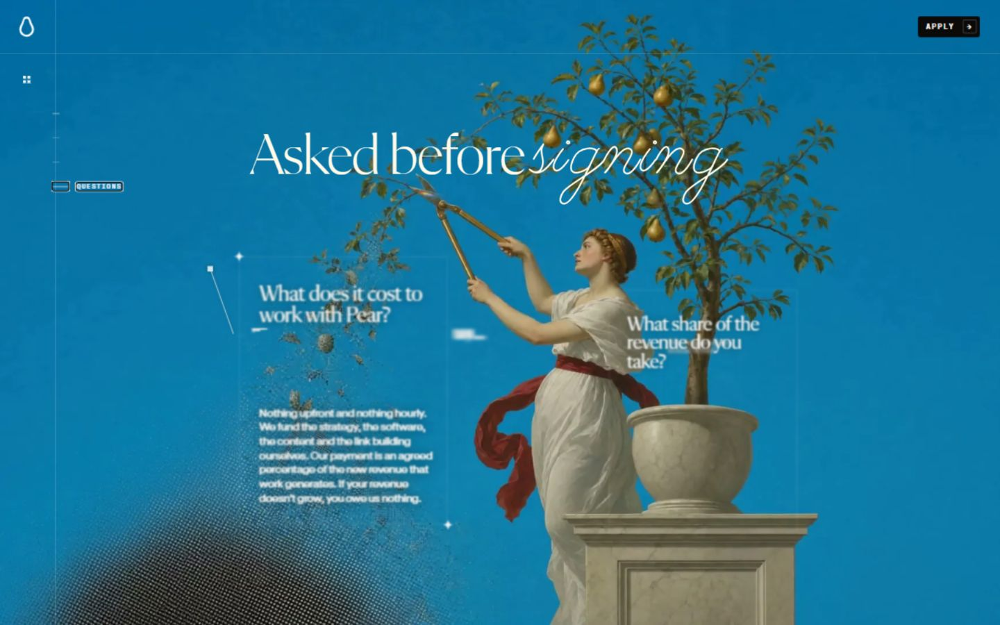

Questions appear as floating, perspective-transformed panels around a figure and tree. A large serif title includes an italic flourish. Scrolling brings questions and answers into the composition; this is not a conventional accordion. It is memorable but makes side-by-side scanning and quick answer retrieval harder. The visible questions layer retained `aria-hidden="true"` during the check.

### Step 7 — Application: reachable immediately; form clarity needs care

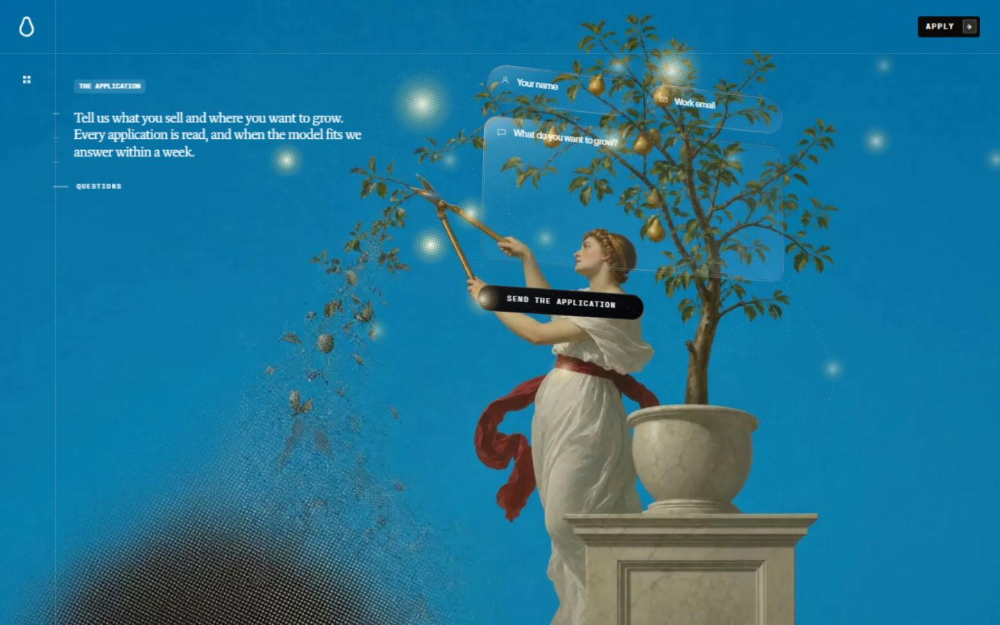

The top action and hero CTA reveal the application within the visual scene. In the tested state, it appeared over the current background rather than navigating to a separate page. Fields use glass-like translucent outlines, perspective, and a pill-shaped submit button. The form contains name, email, and a longer message field.

The fields had placeholders but no associated labels, IDs, or `aria-label` values in the inspected DOM; the accessibility tree returned unnamed fields. Placeholder-only labeling is fragile. No personal data was entered and the form was not submitted. Source code contains basic validation, sending/success/error states, a same-origin API call, and a challenge token flow; their live backend behavior is unverified.

### Step 8 — Ending: a clear change of pace

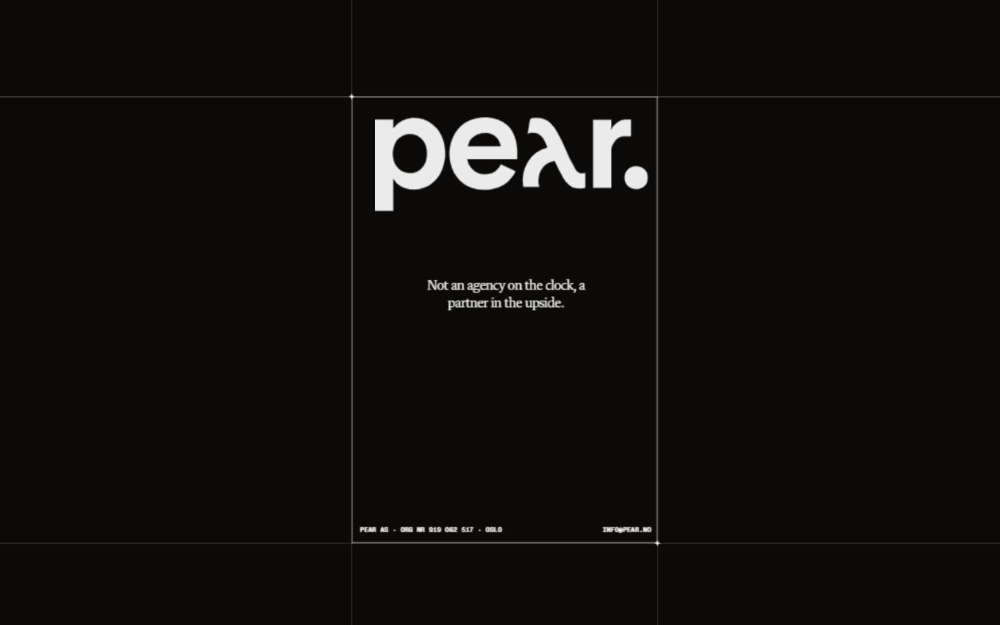

The ending uses a near-black field, huge wordmark, a narrow grid-aligned column, compact positioning text, and small legal/contact details. It feels like the closing page of a publication. This is a useful pattern for Adam’s final contact section: strong identity, one clear action, and little competing content.

### Step 9 — Mobile: art direction survives; simplify the practical tasks

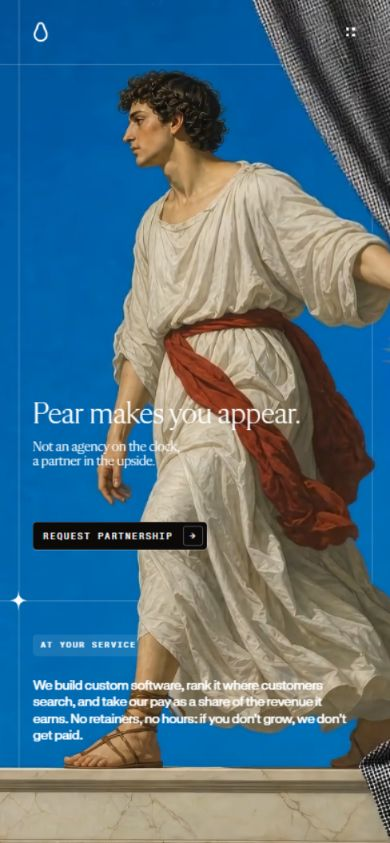

The logo and menu move into the top corners, desktop chapter links disappear, and the persistent top Apply action is hidden. The hero CTA remains available. The figure fills much more of the frame and the lower copy stacks vertically. The grid remains part of the composition.

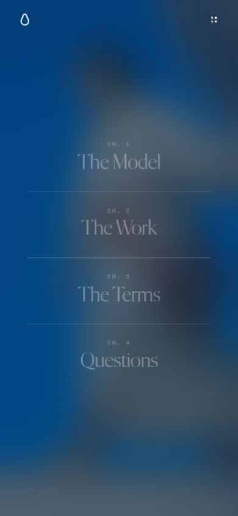

The full-screen chapter list fits the mobile width, but shares the keyboard-focus issue recorded in Step 2. The very light menu text over the blurred background deserves contrast measurement.

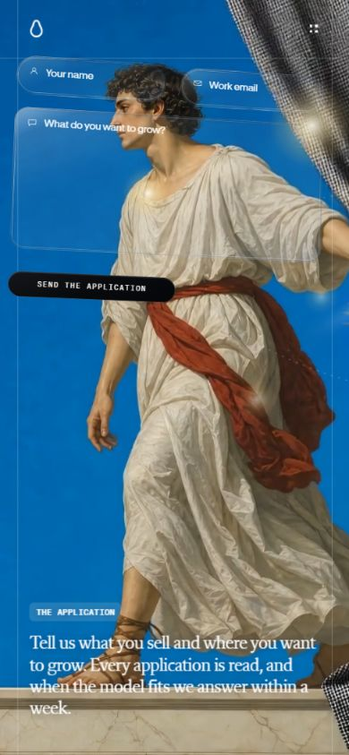

The form sits toward the top and explanatory copy near the bottom. The controls remain highly stylized and perspective-transformed. A personal portfolio would benefit from an ordinary, stable contact layout with persistent labels and unambiguous touch targets.

## 3. Detectable technology

| Technology / mechanism | Confidence | Evidence and limits |
| --- | --- | --- |
| React / React DOM 19.2.8 | Confirmed in public bundle | Version strings and `createRoot(...).render(...)` |
| Tailwind CSS 4.3.3 | Confirmed in delivered CSS | Explicit version banner and generated layers; extensive custom CSS also present |
| Vite-style build pipeline | Inferred, not confirmed | Hashed `/assets/index-*.js` and CSS files, module script and module-preload support are consistent with Vite, but do not prove the build tool |
| Direct WebGL and GLSL | Confirmed | Canvas `getContext('webgl')`, shader compilation, texture/render setup; this is more than CSS parallax |
| Custom animation loop | Confirmed | `requestAnimationFrame`, direct style updates, normalized scroll positions, character spans and effect state |
| Custom desktop smooth scrolling | Confirmed | Wheel/keyboard interception and interpolation of current toward target scroll position; source excludes reduced-motion/coarse-pointer modes from that smoothing |
| Video and image sequences | Confirmed | MP4 sources, JPEG posters, frame-sequence loaders and manifests; full asset transfer volume was not measured |
| SVG effects and CSS perspective | Confirmed | Turbulence/displacement filters, clipping and perspective transforms; form and question layers use 3D transforms |
| Cloudflare at the edge | Confirmed | HTTP response included `Server: cloudflare` and `CF-Cache-Status: HIT`; this does not establish origin hosting or deployment product |
| Cloudflare Turnstile | Confirmed integration in source | Explicit challenge script URL and token submitted by the form; challenge flow not executed |
| Application endpoint | Confirmed client integration | POST to `/api/apply`; backend implementation and delivery provider unknown |
| SEO metadata | Confirmed | Canonical URL, description, Open Graph/Twitter metadata and Organization JSON-LD; served HTML contains page copy |
| CMS, database, authoring tools, image-generation tools | Unknown | No reliable evidence sufficient to identify them |

No GSAP, ScrollTrigger, Lenis, or Three.js names were found in the inspected main bundle. That is not definitive proof that a library is absent; it does mean there is no reason to prescribe those dependencies based on this inspection. There was no positive evidence that this page uses Next.js.

The inspected decoded files were approximately 324KB JavaScript, 62KB CSS, and 54KB HTML, before images, video, sequences, and fonts. These are saved response-body file sizes, **not compressed transfer sizes, initial-load totals, or performance scores**. No Lighthouse/Core Web Vitals claim is made.

Reduced-motion handling exists in CSS and JavaScript, but the complete experience was not tested under that preference. Its presence alone does not prove that all media and motion stop or that the content becomes easily readable.

## 4. Translation to Adam’s portfolio

### Existing identity worth retaining

The repository already uses a text-canvas/brutalist vocabulary: black/white/red, mono labels, indexed navigation, typographic content, and small reveal animations. Current content centers on Adam Ahsan in Dubai, technology and creativity, Layla AI, Qeemat, and commentary. Those are useful raw materials for an original visual story.

The live source routes are `/projects`, `/projects/[slug]`, `/writing`, `/writing/[slug]`, `/about`, and `/contact`. AGENTS.md contains older route names; use the actual source routes when implementing. Content already lives in `src/lib/projects.ts` and `src/lib/posts.ts`.

### Recommended direction: an editorial portfolio with one expressive stage

1. **Hero:** Adam’s name, one clear personal positioning sentence, and a visual rooted in his own work. Explore a typographic composition using existing text-canvas material or original project imagery. Keep a direct “View projects” action and a secondary writing link.
2. **Selected work:** show Layla AI and Qeemat promptly, with useful descriptions and Adam’s role. Use large imagery or a deliberate typographic presentation, fine rules, and compact metadata. Keep normal case-study URLs.
3. **Commentary:** adopt publication-like hierarchy: serif display moments if selected, readable sans-serif summaries, mono dates/categories, generous spacing.
4. **About:** personal context and interests in Adam’s voice. Use expressive imagery only when it says something meaningful about him.
5. **Contact:** a confident closing composition with a straightforward action. Retain a simple, accessible route rather than a floating animated form.

### Borrow / adapt / leave behind

| Borrow | Adapt to Adam | Leave behind |
| --- | --- | --- |
| Fine grid rules and editorial rhythm | Use existing numbered index and text-canvas grid | A 50–70-viewport compulsory animation journey |
| Serif/sans/mono contrast | Test with current fonts before buying or adding families | Pear’s wordmark, slogans, classical characters, proprietary assets |
| Large focal image and intentional negative space | Real project visuals or a personal visual motif | Hiding useful project content behind scene progress |
| Short, tactile transitions | Existing Reveal component and CSS first | Custom wheel interception as a default |
| Confident single primary CTA | Projects first, contact available throughout | Placeholder-only fields and focus escaping overlays |
| Strong closing page | Adam’s identity and contact details | Transforming practical forms into hard-to-read scenery |

### Implementation implications, when a direction is selected

Keep the existing Next.js App Router / React / TypeScript / Tailwind stack and static export. Most of the useful visual changes require typography, composition, art assets, and CSS—not an architecture migration. Introduce WebGL only if a selected visual concept genuinely depends on it, and then isolate it to a decorative client component with a static fallback.

Likely touchpoints: `src/app/page.tsx`, `src/app/globals.css`, `src/app/layout.tsx` for font choices, and existing layout/reveal components. Preserve content/data separation, navigation, metadata, reduced-motion behavior, and the current mobile menu’s focus handling. Article and project pages should remain readable without an animation runtime.

Suggested build order: visual direction and hero composition → typography/grid tokens → selected-work and writing layouts → modest motion → responsive/accessibility/performance checks. After implementation, run the repository’s build and lint checks. No build was necessary for this documentation-only research.

### Acceptance criteria for the future redesign

- A visitor can identify Adam and reach a project immediately.
- Projects, writing, about, and contact retain real navigable URLs.
- Mobile layouts are composed deliberately, with readable text over every image state.
- Keyboard focus enters, stays within, and exits any overlay predictably.
- Meaningful content is not hidden from assistive technology while visually presented.
- Reduced motion provides a calm, complete experience; media failure leaves useful content.
- The visual identity remains recognizably Adam’s, with no borrowed Pear branding/assets.
- Performance is measured on the implemented design rather than inferred from appearance.

Open design choices for a later brief: which aspect of Pear matters most to Adam—typography, atmosphere, motion, or composition; whether red remains the signature accent; and whether the homepage prioritizes employers/collaborators, readers, or product users. These do not prevent using the research now.

## 5. Sources and verification limits

- [Live reference](https://pear.no/) — all visual/interaction observations, captured on the date above.
- [Public JavaScript bundle](https://pear.no/assets/index-BhJdAf8K.js) — framework and animation/form evidence.
- [Public CSS bundle](https://pear.no/assets/index-Bd_JnIbr.css) — typography, tokens, breakpoints and timeline dimensions.
- [Concise technical evidence](evidence/technology-evidence.json) — file hashes, byte sizes and small implementation signatures for reproducibility. Asset URLs may change on deployment.
- [Mobile application accessibility snapshot](evidence/mobile-application-ax.txt) — field naming and visible UI evidence.
- Local portfolio sources inspected: package.json, next.config.ts, homepage, global styles, root layout, navigation, projects and posts helpers.

Not covered: authenticated/backend behavior, successful form submission, actual screen-reader operation, physical mobile hardware, network-throttled performance, every intermediate animation frame, a full WCAG audit, or image/font ownership provenance. No attribution to an agency, AI tool, CMS or hosting origin is made without evidence.
